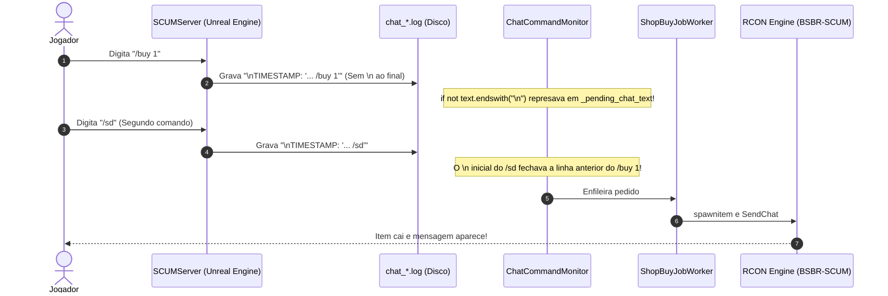

# 🛒 Entrega Instantânea de Compras via Chat e RCON

> [!NOTE] Visão Geral
> Documentação técnica detalhada sobre a arquitetura de entrega imediata de compras in-game (`/buy` e `/kit`) via **Source RCON** nativo no **SSM 3.0**, eliminando represamentos de buffers de disco do SCUM e latências desnecessárias de rede.

---

## 🔍 1. O Problema: Diagnóstico da "Ilusão do Segundo Comando"

Historicamente, os jogadores relatavam que ao digitar `/buy 1` no chat do jogo, o item não caía imediatamente. Para forçar a entrega, muitos adquiriram o hábito de digitar `/sd` (comando de saldo) logo em seguida, momento em que o item era entregue.

### A Causa Raiz
Ao analisar os logs de baixo nível do servidor (`scum_backend.log` e `rcon_*.log`), identificamos dois gargalos combinados:

1. **Formato Nativo de Log do SCUM (Unreal Engine)**:
   O logger do SCUMServer grava a quebra de linha `\n` no **começo** de cada nova mensagem, e o final da mensagem fecha com aspas simples (`'Canal: Mensagem'`) sem nenhum caractere de newline `\n` ao final. O `ChatCommandMonitor` verificava estritamente `if not text.endswith("\n"):`, o que fazia com que toda nova linha única ficasse retida em `_pending_chat_text`. Quando o jogador digitava o segundo comando (`/sd`), o `\n` inicial dele fazia o monitor finalmente reconhecer o `/buy` anterior como linha completa e enviá-lo para processamento.
2. **Consulta Bloqueante `ListPlayers` no RCON**:
   Antes de entregar qualquer pedido, o backend executava uma chamada síncrona `ListPlayers` na RCON para saber se o SteamID estava online. Se a RCON estivesse processando outros comandos ou sofresse timeout, a entrega era suspensa como `pending`. Em compras do próprio chat, essa checagem era redundante.
3. **Polling do Worker em Background**:
   O worker de compras dormia 2 segundos entre iterações (`poll_interval_seconds = 2.0`), gerando atraso artificial entre a leitura do chat e a criação do pedido.

---

## ⚙️ 2. Arquitetura da Solução Implementada

### 2.1 Parsing Nativo de Linhas SCUM (Sem Represamento)
No arquivo `core/logs/chat_command_monitor.py`:
- Eliminada a restrição de que o buffer termine em `\n`.
- As linhas são separadas por `\n`. Se a última linha terminar em aspas simples `'` ou for validada por `_parse_chat_line()`, ela é processada imediatamente.
- Apenas linhas incompletas / truncadas permanecem em `_pending_chat_text`.

### 2.2 Leitura Real do File Handle (Bypass de Cache NTFS)
No arquivo `core/logs/chat_command_monitor.py`:
- Em vez de confiar em `os.path.getsize`, o monitor abre o descritor de arquivo original em modo binário (`open(file_path, "rb")`).
- Através de `f.seek(0, 2)` seguido de `f.tell()`, consulta diretamente o ponteiro real no kernel do Windows, identificando instantaneamente os novos bytes gravados pelo SCUM.

### 2.2 Entrega Direta com Bypass de `ListPlayers`
No arquivo `core/shop/delivery_service.py`:
- Implementado o método `deliver_single_order_now(order_id: str)`.
- Adicionado o parâmetro `bypass_online_check=True` no método `_deliver_order_rcon`.
- Como o pedido veio de uma mensagem no chat enviada milissegundos antes, a presença do jogador é garantida:
  $$\text{Origem} = \text{Chat In-Game} \implies \text{Status do Jogador} = \text{Online Garantido}$$
- Os comandos de entrega são despachados sem esperar o ciclo do `ListPlayers`:
  1. `spawnitem <ItemClass> <Qty> Location "<SteamID>"`
  2. `SendChat 6 "[SSM] Seus itens foram entregues com sucesso!" <SteamID>`

### 2.3 Fila Instantânea com Thread Event
No arquivo `core/shop/shop_buy_job_worker.py`:
- Criado o sinalizador de classe `_global_wake_event = threading.Event()`.
- Assim que o `enqueue_buy_job` insere o pedido na tabela `shop_buy_job`, ele aciona `_global_wake_event.set()`.
- O worker acorda no mesmo milissegundo, processa a ordem e despacha a entrega unitária imediata.

### 2.4 Blindagem Anti-Crash para Entregas Simultâneas em Massa (v3.22.70 – v3.22.72)
Para evitar que múltiplos jogadores entrando ao mesmo tempo e pedindo kits de boas-vindas (`/register` e `/kit`) sobrecarreguem ou congelem a **Game Thread** da Unreal Engine (`"erro: sem resposta em 4s - o tick do jogo pode estar parado"`):

1. **Serialização Estrita com `_delivery_lock` e Cooldown Inter-Pedidos (`2.5s`)**:
   - Tanto `run_once()` quanto `deliver_single_order_now()` (usado por `/buy`, `/kit` e `/register`) adquirem o mesmo `_delivery_lock` global.
   - Isso impede que dois kits sejam entregues ao mesmo tempo ou intercalem comandos `spawnitem` na fila RCON.
   - Entre o término de um pedido e o início do próximo, o helper `_wait_inter_order_cooldown()` aplica uma pausa de `2.5s` para o coletor de lixo e replicação da Unreal Engine estabilizarem.
2. **Ordenação Inteligente de Sub-Itens em Kits (`Weapon_*` Primeiro) e Pausa por Lote**:
   - O `bsbr_scum` converte `Location "<SteamID>"` para a coordenada exata `{X, Y, Z}` do cápsula do jogador. Instanciar uma arma complexa (`Weapon_MP5`) como 10º/11º item em cima de uma pilha de 15 objetos físicos recém-spawnados no mesmo milímetro `(X, Y, Z)` causava deadlock na Game Thread (`UAdminCommand_SpawnItem`).
   - O helper `_kit_subitem_priority()` reordena automaticamente a execução de qualquer kit para spawnar **Armas (`Weapon_*`) primeiro** (quando há `0` itens empilhados no chão), seguidas dos itens comuns e **Veículos (`BPC_*` / `BP_*`) por último**.
   - A cada **4 itens** spawnados em um kit (`_KIT_BATCH_SIZE = 4`), o SSM aplica uma pausa de respiro de `2.5s` (`_KIT_BATCH_PAUSE_SEC`) para a física da UE4 assentar os itens antes do próximo lote.
3. **Cadência Adaptativa por Complexidade do Ator (*Throttling*)**:
   - Itens comuns utilizam `delay_after = 0.8s`.
   - Atores pesados (`_is_heavy_actor`: armas `Weapon_*` e veículos `BPC_*` / `BP_*`) utilizam `delay_after = 2.0s`.
4. **Detecção de Congelamento de Tick, *Circuit Breaker* e Prevenção de Loop de Crash Pós-Reinício**:
   - Funções `is_rcon_tick_frozen()` e `is_rcon_error_response()` inspecionam o retorno de cada comando RCON.
   - Se o servidor reportar congelamento de tick ou timeout, o `RconQueueManager` reinicializa o socket e abre o **Circuit Breaker** por `15s` a `45s`, abortando comandos de spawn/listagem subsequentes em `0ms` (mas mantendo `SendChat` como `/sd` liberado).
   - Se um pedido causar `RCON_TICK_FROZEN`, `_revert_or_fail_order()` marca o pedido como `failed` (`retry_requested = 0`) em vez de `pending`, impedindo que um pedido problemático volte a rodar automaticamente 30 segundos após cada reinício do `SCUMServer.exe`.
5. **Eliminação Total de `ListPlayers` Desnecessário**:
   - Comandos digitados no chat (`/register`, `/kit`, `/buy`) nunca executam `ListPlayers`, pois o jogador comprovadamente já está online no jogo.
   - O worker periódico `run_once()` verifica primeiro no SQLite se há pedidos aguardando na fila (`attempt_count > 0` ou `created_at <= -15s`) antes de chamar `ListPlayers`, evitando qualquer corrida com `deliver_single_order_now()` ou chamadas RCON quando a fila está vazia.
6. **Sanitização Automática de `StackCount` e Typos (`_build_spawnitem_cmd`)**:
   - Corrige automaticamente typos conhecidos como `Water_051` -> `Water_05l` e `Emergency_bandage_Big_S` / `Emergency_bandage_Big_ES` -> `Emergency_bandage_Big`.
   - Quando um item possui `StackCount` embutido no cadastro (ex.: `Cash 1 StackCount 5000` com `qty=2`), posiciona a quantidade corretamente antes de `StackCount` (`spawnitem Cash 2 StackCount 5000 Location "<SteamID>"`).

---

## 📊 3. Comparativo de Performance

| Métrica | Fluxo Anterior | Novo Fluxo Otimizado (v3.22.70) |
| :--- | :--- | :--- |
| **Detecção do Chat** | Dependia do flush de 2º comando | **Instantânea** (Seek no Handle) |
| **Espera do Worker** | Polling de até 2.0s | **0 ms** (`_global_wake_event`) |
| **Checagem de Online** | `ListPlayers` RCON (0.5s - 5.0s) | **Bypass** (Garantido pelo Chat) |
| **Concorrência de Kits** | Paralela sem lock (intercalava spawns) | **Serializada** (`_delivery_lock` + `2.5s` cooldown) |
| **Proteção contra Freeze UE4** | Cega (continuava enviando por 30 min) | **Circuit Breaker + Retomada por Sub-Item** |

---

## 🔗 4. Documentos e Links Relacionados

- [[diario_de_bordo#⚡ 32. Otimização e Entrega Instantânea de Compras da Loja via Chat In-Game (/buy) e RCON|Diário de Bordo - Seção 32]]
- [[diario_de_bordo#🛡️ 33. Blindagem Anti-Crash de Entregas RCON em Massa (Circuit Breaker, Serialização e Progresso por Sub-Item)|Diário de Bordo - Seção 33]]
- [[SHOP_ECONOMY_SYSTEM|Sistema de Economia e Loja (SSM)]]
- [[SHOP_NOTIFICATIONS_RCON|Notificações RCON Dinâmicas da Loja]]
- [[rcon_mod_manager|Gerenciador Nativo BSBR-SCUM]]

